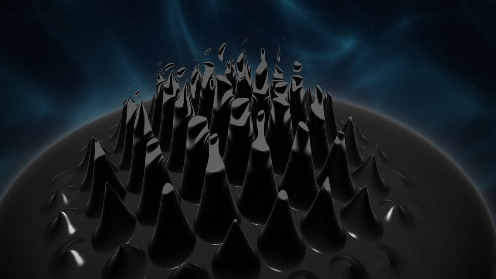
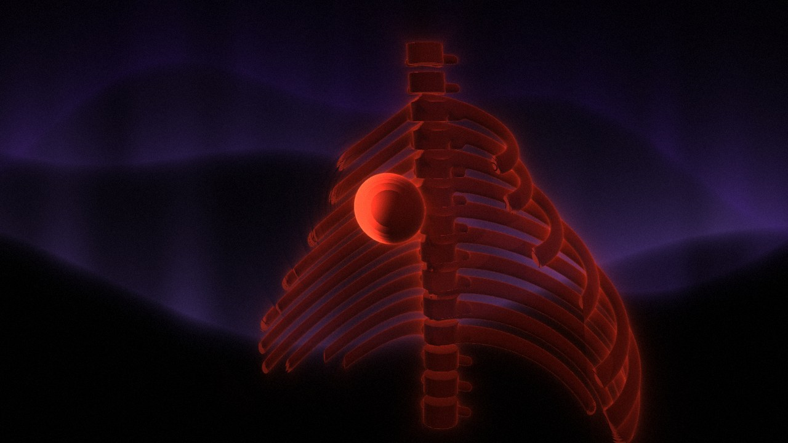
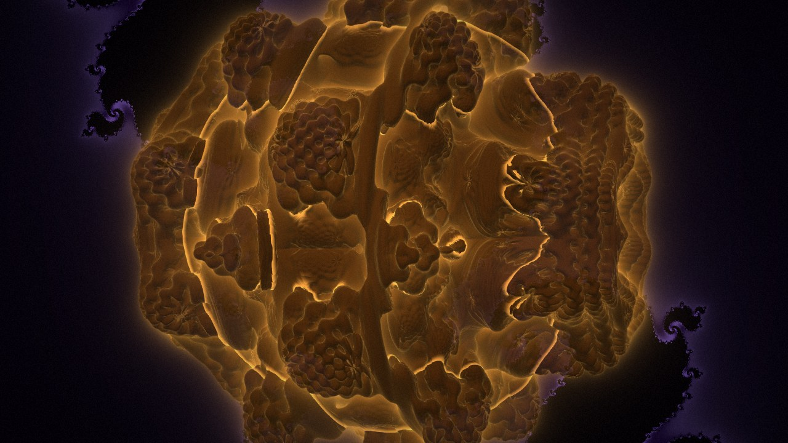
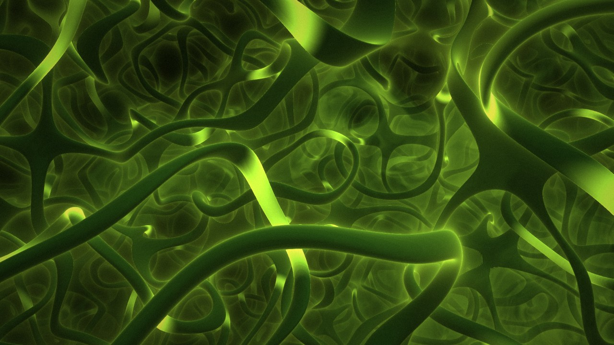
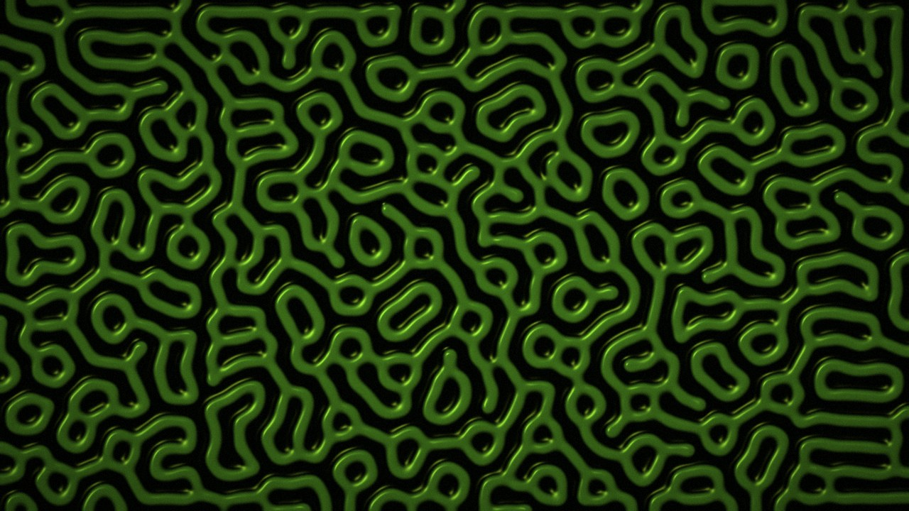
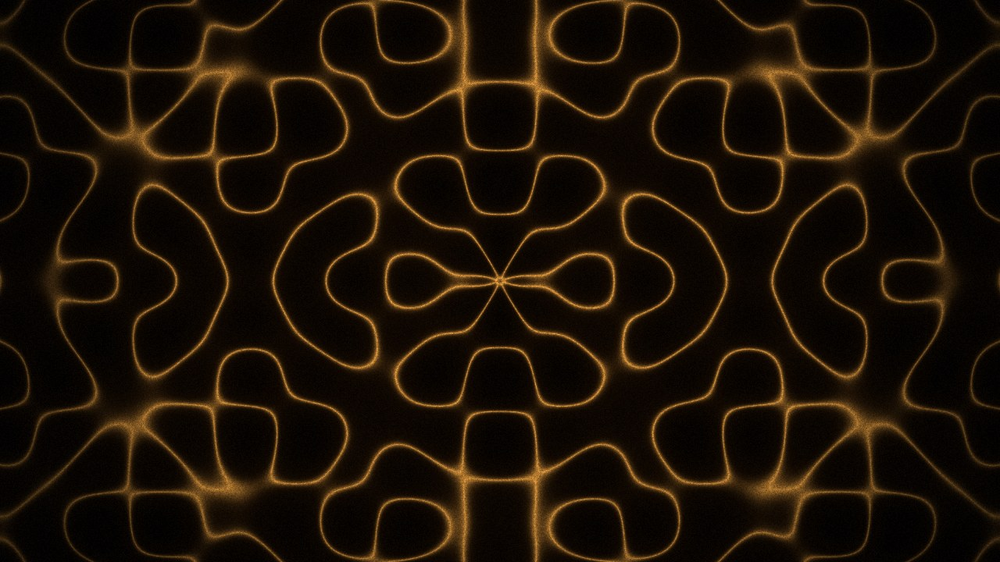
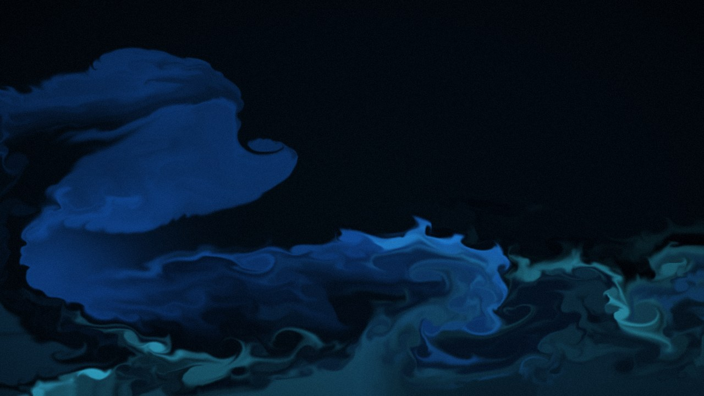

# DRIFT — live visuals for hypnotic & deep techno



DRIFT is a browser-based VJ tool for DJs. Every visual is a GLSL shader rendered live on
the GPU: raymarched 3D scenes, fractals, organic forms, and real fluid and reaction–diffusion
simulations. They react to the music you play, follow its tempo, and can run on autopilot.
You can also drive everything by hand or from a MIDI controller.

**[▶ Live demo](DEMO_URL)**: open it in Chrome. It runs in demo mode with a synthetic beat
until you pick an audio input.

No dependencies, no build step, no framework. It is plain ES modules, WebGL2, Web Audio and Web MIDI.

| | | |
|---|---|---|
|  |  |  |
|  |  |  |

## Features

- **Two layers.** A *depth* foreground (27 scenes: raymarched 3D, fractals such as the Menger
  sponge, Mandelbulb, KIFS and Apollonian gasket, and organic and liquid forms) is composited
  over a *backdrop* (27 flat textures, including a GPU fluid solver and Gray–Scott
  reaction–diffusion). Each layer has its own palette, intensity, reactivity, speed and
  transition length. Layers can be blended as normal, screen, mask or difference.
- **Audio analysis.** Four bands with per-band automatic gain. The kick is detected from
  spectral flux in the sub band. A BPM clock locks onto the kicks using an interval histogram,
  regression and a PLL. Tap tempo, typed BPM and MIDI clock are also supported. The tool also
  detects breakdowns and drops.
- **Autopilot.** Changes scenes, variations, palettes and blend modes on phrase boundaries. It
  calms down in breakdowns and cuts back in hard on the drop.
- **Manual drop.** Arm a drop 1, 4, 8 or 16 bars ahead. You choose what builds up during the
  countdown (blur, acceleration, darkening, strobe, glitch, shatter) and which scene, backdrop
  and palettes come in on the drop.
- **Performance FX.** Flash, strobe, blackout, an RGB-split glitch, and *shatter*, which breaks
  the image into falling Voronoi shards.
- **Variations.** Each scene has four smoothly interpolated parameters. One button reshapes the
  scene without changing it.
- **Projector output.** A separate output window opens on the second screen (Window Management
  API). The control panel stays on the laptop.
- **MIDI.** Learn mode (click a control, move a knob), a mapping table with live values,
  automatic detection of absolute vs relative encoders, and a built-in preset for the
  Arturia MiniLab 3.
- **Keyboard shortcuts** for everything. Press `?` in the app to list them.

## Run it locally

```bash
git clone REPO_URL drift && cd drift
python3 serve.py 8080        # or: npm start
```

Open <http://localhost:8080> in **Chrome**. The microphone, audio inputs and MIDI only work on
`localhost` or HTTPS. Opening `index.html` from disk does not work.

### Getting sound in

1. **Line from the mixer to an audio interface** (best). Take booth, rec or a second master
   output into any USB interface and pick it from the source list.
2. **DJ software on the same Mac.** Route its master through
   [BlackHole](https://existential.audio/blackhole/) and pick "BlackHole 2ch".
3. **Microphone.** This works too: browser voice processing is disabled. Raise the
   **sensitivity** slider (0…+40 dB) until the green IN meter reaches past half.
4. **No sound.** Use demo mode, tap tempo, or pick "Audio file…" to rehearse with a recording.

## Controls at a glance

| Key | Action |
|---|---|
| `1`–`0`, `Q`… | depth scene (`Shift` = hard cut) |
| `G` / `Shift+G` | next / previous backdrop |
| `V` / `Shift+V` | new variation of depth / backdrop |
| `P` / `Shift+P` | next palette of depth / backdrop |
| `← →` `↓` | layer balance / centre |
| `M` | blend mode |
| `Space` | autopilot |
| `T` / `Enter` | tap tempo / mark phrase start |
| `D` | arm / cancel manual drop |
| `X` / `S` / `B` | flash / strobe (hold) / blackout |
| `Z` / `C` | glitch (hold) / shatter |
| `O` / `F` / `H` | output window / fullscreen / hide panel |

## How it is built

```
js/audio.js        audio input, band analysis, kick detection, BPM clock, demo signal
js/director.js     state, autopilot, breakdown/drop logic, builds one frame object per tick
js/engine.js       WebGL2 renderer: two layers, transitions, trails, composite, post FX
js/scenes.js       all scenes as GLSL source (signed distance functions + shared raymarcher)
js/sim.js          stateful scenes: stable-fluids solver, Gray–Scott reaction–diffusion
js/midi.js         Web MIDI: learn, mapping, encoder modes, clock
js/main.js         control panel and output window
```

- **Adding a scene** means adding one object to `js/scenes.js`: an id, a name, a layer and
  GLSL. For 3D scenes you write `float map(vec3 p)` and call the shared `march()` and `shade()`.
  A scene that fails to compile is marked red in the panel, and the rest keeps running.
- **Adding a palette** is one line in `js/palettes.js`.
- **Tests** cover the audio analysis, BPM clock, MIDI encoder logic and scene definitions. They
  run in Node with no dependencies:

  ```bash
  npm test
  ```

Code comments and the UI are in Polish. A detailed Polish manual is in
[README.pl.md](README.pl.md).

## Performance

Most scenes render in 3–10 ms per frame at 1080p on an Apple-silicon MacBook. Simulations run
on fixed-size grids, so their cost does not grow with resolution. The FPS counter in the
preview shows the output window's frame rate while that window is open.

## License

[MIT](LICENSE)
